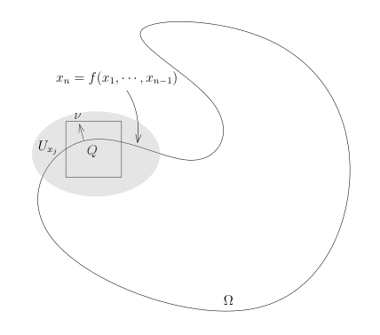

# 勘误：47 球体积与 Stokes 公式的第一个证明

[返回勘误目录](../../errata.md) · [数学分析 2 勘误](../02-math-analysis-ii.md)

[相关正文：47：球体积与 Stokes 公式的第一个证明](../../02-math-analysis-ii/47-stokes-first-proof.md)

## 数学修正

**原文：**

> 对于 $n \geqslant 1$, 我们令

**修正：**

> 以 $c_1=2$ 为初值；对于 $n\geqslant2$ 以及 $a\in[-1,1]$，我们令

**理由：** 球体截面递推使用n减一维球，从一维初值起对n大于等于二使用，截面半径公式还要求高度绝对值不超过一。

**原文：**

> $$
> \begin{aligned}
> c_n = m(B(1)) &= \int_{-1}^1 m(B'_{x_n}) d x_n \\
> &= 2 \int_0^1 (1 - x_n^2)^{\frac{n-1}{2}} c_{n-1} d x_n \\
> &= 2 c_{n-1} \int_0^{\frac{\pi}{2}} \sin^n \theta d\theta.
> \end{aligned}
> $$

**修正：**

> $$
> \begin{aligned}
> c_n = m_n(B(1)) &= \int_{-1}^1 m_{n-1}\bigl(\{x'\mid(x',x_n)\in B(1)\}\bigr) d x_n \\
> &= 2 \int_0^1 (1 - x_n^2)^{\frac{n-1}{2}} c_{n-1} d x_n \\
> &= 2 c_{n-1} \int_0^{\frac{\pi}{2}} \sin^n \theta d\theta.
> \end{aligned}
> $$

**理由：** Rn中超平面截面对n维Lebesgue测度为零，降维体积应使用前n减一坐标的Lebesgue测度。

## 原讲义笔误（正文已订正）

**原讲义片段：**

> (1−xn²)^(n−1)

**正文：**

> $$
> \begin{aligned}
> c_n = m_n(B(1)) &= \int_{-1}^1 m_{n-1}\bigl(\{x'\mid(x',x_n)\in B(1)\}\bigr) d x_n \\
> &= 2 \int_0^1 (1 - x_n^2)^{\frac{n-1}{2}} c_{n-1} d x_n \\
> &= 2 c_{n-1} \int_0^{\frac{\pi}{2}} \sin^n \theta d\theta.
> \end{aligned}
> $$

**理由：** 截面半径为sqrt一减高度平方，n减一维体积缩放指数应为其半次，canonical已修复源图漏二分母。

[相关正文：47：球体积与 Stokes 公式的第一个证明](../../02-math-analysis-ii/47-stokes-first-proof.md)

## 数学修正

**原文：**

> 对于 $a, b \in [-1, 1]$, 我们令
> $$\mathbb{S}^2(a, b) = \{(x, y, z) \in \mathbb{S}^2 \mid a \leqslant z \leqslant b\}.$$

**修正：**

> 对于 $-1\leqslant a\leqslant b\leqslant1$，我们令
> $$\mathbb{S}^2(a, b) = \{(x, y, z) \in \mathbb{S}^2 \mid a \leqslant z \leqslant b\}.$$

**理由：** 后文面积公式为二pi乘b减a，必须规定上下界顺序，反序的带状区域为空而公式为负。

[相关正文：47：球体积与 Stokes 公式的第一个证明](../../02-math-analysis-ii/47-stokes-first-proof.md)

## 数学修正

**原文：**

> $$
> \begin{aligned}
> \sigma(\mathbb{S}^2(0, b)) &= \int_{(0,\pi) \times (0,2\pi)} \sin\theta d\theta d\varphi \\
> &= 2\pi \int_{\arccos b}^{\arccos a} \sin\theta d\theta \\
> &= 2\pi (b - a).
> \end{aligned}
> $$

**修正：**

> $$
> \begin{aligned}
> \sigma(\mathbb S^2(a,b))&=\int_{[\arccos b,\arccos a]\times(0,2\pi)} \sin\theta d\theta d\varphi \\
> &= 2\pi \int_{\arccos b}^{\arccos a} \sin\theta d\theta \\
> &= 2\pi (b - a).
> \end{aligned}
> $$

**理由：** 此处计算一般a到b的球带，角度须限制在两个高度对应区间，原全角度积分是整球面积且左下界误写零。

[相关正文：47：球体积与 Stokes 公式的第一个证明](../../02-math-analysis-ii/47-stokes-first-proof.md)

## 数学修正

**原文：**

> 我们可以类似地计算 $\mathbf{C}(0, b)$

**修正：**

> 我们可以类似地计算 $\mathbf C(a,b)$

**理由：** 参数高度从a到b，所计算的柱带应带同样两个高度而非零到b。

**原文：**

> $$\Phi : (0, 2\pi) \times (a, b) \to \sigma(\mathbf{C}(0, b)), \quad (\theta, s) \mapsto (\cos(\theta), \sin(\theta), s).$$

**修正：**

> $$\Phi : (0, 2\pi) \times (a, b) \to\mathbf C(a,b), \quad (\theta, s) \mapsto (\cos(\theta), \sin(\theta), s).$$

**理由：** 参数映射输出三维点，应以柱面带集合为陪域，不能映到其标量面积。

**原文：**

> $$\sigma(\mathbf{C}(0, b)) = \int_{(0,2\pi) \times (a,b)} d\theta ds = 2\pi(b - a).$$

**修正：**

> $$\sigma(\mathbf C(a,b))=\int_{(0,2\pi)\times(a,b)} d\theta ds = 2\pi(b - a).$$

**理由：** 积分域高度a到b，对应一般柱带面积；原左边零到b与二pi乘b减a不等。

**原文：**

> 中心在 $x$ 处边长为 $4$

**修正：**

> 中心在 $-x$ 处边长为 $4$

**理由：** 求和项chi(x+k)非零要求k接近负x，原将格点中心误写为正x。

[相关正文：47：球体积与 Stokes 公式的第一个证明](../../02-math-analysis-ii/47-stokes-first-proof.md)

## 数学修正

**原文：**

> 对任意的 $\mathbf{k} \in \mathbb{Z}$

**修正：**

> 对任意的 $\mathbf{k} \in \mathbb{Z}^n$

**理由：** 粗体k为n个整数坐标组成的格点，须属于n维整数格而非整数本身。

**原文：**

> 对每个 $\mathbf{k} \in \mathbb{Z}$

**修正：**

> 对每个 $\mathbf{k} \in \mathbb{Z}^n$

**理由：** 粗体k为n个整数坐标组成的格点，须属于n维整数格而非整数本身。

**原文：**

> 那么，$\chi_{\mathbf{k}}$ 在某个边长为 $2^{-N}$ 的正方体上恒为 $1$，把这个正方体扩大一倍之后（边长为 $2^{-N+1}$），$\chi_{\mathbf{k}}$ 在这个大正方体之外恒为 $0$。特别地，这两个正方体的中心落在 $2^{-N+1}\mathbb{Z}^n$ 中（这是更密的格点）。

**修正：**

> 那么，$\chi_{\mathbf k}$ 的支集落在以 $2^{-(N+1)}\mathbf k$ 为中心、边长为 $2^{-N+1}$ 的正方体中，并且在这个正方体之外恒为零。除以 $F$ 后，较小的同心正方体（边长为 $2^{-N}$）上一般不再恒为一。特别地，这些正方体的中心落在 $2^{-(N+1)}\mathbb Z^n$ 中（这是更密的格点）。

**理由：** Fk除以非恒常的F后已无恒一平台，缩放也不会恢复该性质；中心是k除以二的N加一次方，支集边长四除以同一尺度，修复矛盾平台与格点尺度。

**原文：**

> 3) 常值函数 $1$ 可以分解为

**修正：**

> 2) 常值函数 $1$ 可以分解为

**理由：** 引理声明两个条件，应依次编号一和二，第三项编号为源排版误号。

[相关正文：47：球体积与 Stokes 公式的第一个证明](../../02-math-analysis-ii/47-stokes-first-proof.md)

## 数学修正

**原文：**

> $\operatorname{supp}(\chi) \subset [-M, M]$。

**修正：**

> $\operatorname{supp}(\chi)\subset[-M,M]$，其中 $M>0$。令 $C=\int_{\mathbb R}|\chi(s)|\,ds<\infty$。

**理由：** 引理未假设chi非负，估计需使用有限L1绝对值常数；M取正以便除法delta除M。

**原文：**

> $$\left| \int_{\mathbb{R}^1} \frac{1}{\varepsilon}\chi \left( \frac{x}{\varepsilon} \right) f(x)dx - f(0) \right| \leqslant \int_{-\varepsilon M}^{\varepsilon M} \frac{1}{\varepsilon}\chi \left( \frac{x}{\varepsilon} \right) \epsilon dx = \epsilon.$$

**修正：**

> $$\left| \int_{\mathbb{R}^1} \frac{1}{\varepsilon}\chi \left( \frac{x}{\varepsilon} \right) f(x)dx - f(0) \right| \leqslant \int_{-\varepsilon M}^{\varepsilon M}\frac1\varepsilon\left|\chi\left(\frac x\varepsilon\right)\right|\epsilon\,dx=C\epsilon.$$

**理由：** 控制绝对值积分必须取核绝对值，带符号核积分一并不意味着绝对值积分一；C为固定有限常数，epsilon任意小仍得到极限零。

**原文：**

> $\Phi(U \cap \Omega) = V_+ = V \cap \{(x_1, \cdots, x_n) \mid x_n \geqslant 0\}$

**修正：**

> $\Phi(U \cap \Omega) = V_+ = V\cap\{(y_1,\cdots,y_n)\mid y_n\geqslant0\}$

**理由：** V上的坐标约定为y，标准半空间限制应在目标y坐标上。

[相关正文：47：球体积与 Stokes 公式的第一个证明](../../02-math-analysis-ii/47-stokes-first-proof.md)

## 数学修正

**原文：**

> $V \in \mathbb{R}^n$

**修正：**

> $V\subset\mathbb R^n$

**理由：** V是欧氏空间的开子集而非其中一个点，修复成员符号。

**原文：**

> $$\Omega = \{x \in U \mid f(x) \geqslant 0\}.$$

**修正：**

> $$\Omega\cap U=\{x\in U\mid f(x)\geqslant0\}.$$

**理由：** 定义函数f只在局部U上，不能表示整个全局Omega，局部水平集只等于交U部分。

**原文：**

> $$f(p - t\nu(p)) = f(p) - t(\nabla_{\nu(p)} f)(p) + O(t^2) > 0.$$

**修正：**

> $$f(p - t\nu(p)) = f(p) - t(\nabla_{\nu(p)} f)(p) +o(t)>0.$$

**理由：** 区域允许仅C1坐标，一级Taylor余项为o(t)，二阶有界余项需更多光滑性；o(t)足以维持线性主项正号。

[相关正文：47：球体积与 Stokes 公式的第一个证明](../../02-math-analysis-ii/47-stokes-first-proof.md)

## 数学修正

**原文：**

> $$\Omega = \{(x, x_n) \mid x \in \mathbb{R}^n, x_n \in \mathbb{R}, x_n \leqslant f(x)\}.$$

**修正：**

> $$\Omega = \{(x,x_{n+1})\mid x\in\mathbb R^n,\ x_{n+1}\in\mathbb R,\ x_{n+1}\leqslant f(x)\}.$$

**理由：** 图像环境维数n加一，额外高度坐标是xn加一，不能与x内部第n坐标同名。

**原文：**

> $h(x_1, \cdots, x_n) = x_{n+1} - f(x_1, \cdots, x_n)$

**修正：**

> $h(x_1,\cdots,x_n,x_{n+1})=x_{n+1} - f(x_1, \cdots, x_n)$

**理由：** 水平集定义函数需要全部n加一坐标，原左实参漏高度变量。

**原文：**

> 通过限制到更小的局部 $U$ 上，我们可以假设

**修正：**

> 经过必要的坐标置换并限制到更小的局部 $U$ 上，我们可以假设

**理由：** 非零微分只保证至少一个偏导非零，单纯缩小邻域不能让指定末坐标偏导从零变非零，须先置换坐标。

[相关正文：47：球体积与 Stokes 公式的第一个证明](../../02-math-analysis-ii/47-stokes-first-proof.md)

## 数学修正

**原文：**

> $\partial\Omega = U_{x_1} \cup \cdots \cup U_{x_m}$

**修正：**

> $\partial\Omega\subset U_{x_1}\cup\cdots\cup U_{x_m}$

**理由：** 开邻域并包含紧边界，不能等于余维一闭子流形，紧性结论是有限子覆盖。

[相关正文：47：球体积与 Stokes 公式的第一个证明](../../02-math-analysis-ii/47-stokes-first-proof.md)

## 数学修正

**原文：**

> 由于 $\frac{\partial\varphi}{\partial x_i}$ 在 $\partial\Omega$ 上为 0

**修正：**

> 由于 $\varphi$ 及 $\frac{\partial\varphi}{\partial x_i}$ 在 $\partial\Omega$ 上为零

**理由：** Stokes右边的被积函数是phi乘法向分量，需指出phi本身在边界为零；其支集远离边界恰保证该性质。

**原文：**

> **第四步**, 正方体 $Q$ 与边界 $\partial\Omega$ 相交的情况: $Q \cap \mathring{\Omega} \neq \emptyset$, 此时, 我们可以假设 $Q \subset U_{x_j}$, 其中, $U_{x_j}$ 是第一步中构造的开集。
>
> 
>
> 由于 $\partial\Omega \cap U_{x_j}$ 为函数的图像, 我们不妨假设
> $$
> \partial\Omega \cap U_{x_j} = \{(x_1, \cdots, x_{n-1}, x_n) \mid x_n = f(x_1, \cdots, x_{n-1})\}.
> $$
> 我们还假设 $\Omega$ 是函数图像下的部分, 即 $x_n \leqslant f(x_1, \cdots, x_{n-1})$。我们定义
> $$
> \rho(x_1, \cdots, x_n) = x_n - f(x_1, \cdots, x_{n-1}).
> $$
> 并且选取函数光滑递增的单变量实函数 $\theta(x)$:
> $$
> \theta(t) = \begin{cases}
> 1, & x \geqslant 1; \\
> 0, & x \leqslant -1.
> \end{cases}
> $$

**修正：**

> **第四步**，正方体 $Q$ 与边界 $\partial\Omega$ 相交的情况：$Q\cap\partial\Omega\ne\emptyset$。此时可以假设 $Q\subset U_{x_j}$，其中 $U_{x_j}$ 是第一步构造的图像邻域，并且 $\operatorname{supp}\varphi\subset Q$。
>
> 
>
> 记 $x'=(x_1,\ldots,x_{n-1})$。经过必要的坐标置换、反向并缩小邻域，可设
> $$
> \partial\Omega\cap U_{x_j}=\{(x',x_n)\in U_{x_j}\mid x_n=f(x')\},
> \qquad
> \Omega\cap U_{x_j}=\{(x',x_n)\in U_{x_j}\mid x_n\leqslant f(x')\}.
> $$
> 在此邻域定义
> $$
> \rho(x)=x_n-f(x').
> $$
> 所以 $\Omega$ 在局部位于 $\rho\leqslant0$ 的一侧，外法向沿着 $\nabla\rho$ 的方向。选取光滑非递减函数 $\theta$，满足 $0\leqslant\theta\leqslant1$ 以及
> $$
> \theta(t)=\begin{cases}1,&t\geqslant1;\\0,&t\leqslant-1.\end{cases}
> $$

**理由：** 图像下方区域须用交边界条件与局部一侧定义，rho正侧是外部；明确此方向后统一采用一减theta逼近内部，消除后页整体符号矛盾。

[相关正文：47：球体积与 Stokes 公式的第一个证明](../../02-math-analysis-ii/47-stokes-first-proof.md)

## 数学修正

**原文：**

> (函数的存在性请参考上个学期作业七习题 F) 我们知道, 当 $\varepsilon \to 0$ 时, 我们有函数的逐点收敛:
> $$
> \theta \left( \frac{\rho(x)}{\varepsilon} \right) \longrightarrow \mathbf{1}_{\Omega \cap Q}.
> $$
> 根据 Lebesgue 控制收敛定理, 我们有
> $$
> \begin{aligned}
> \int_{\Omega} -\frac{\partial\varphi}{\partial x_i}(x) dx &= \int_Q -\frac{\partial\varphi}{\partial x_i}(x) dx \\
> &\overset{\text{Lebesgue}}{=} \lim_{\varepsilon \to 0} \int_Q -\frac{\partial\varphi}{\partial x_i}(x) \theta \left( \frac{\rho(x)}{\varepsilon} \right) dx \\
> &= \lim_{\varepsilon \to 0} \int_Q \frac{1}{\varepsilon} \theta' \left( \frac{\rho(x)}{\varepsilon} \right) \frac{\partial\rho}{\partial x_i}(x) \varphi(x) dx.
> \end{aligned}
> $$
> 最后一个等号我们利用 Fubini 公式可以对 $x_i$ 变量进行分部积分, 这和第三步中的计算一模一样。
>
> 为了可以利用 Newton-Leibniz 公式, 我们构造一个微分同胚(坐标变换)把 $\Omega \cap Q$ 变成矩形。我们变量替换
> $$
> H : \Omega \cap Q \to \mathbb{R}^n_- = \{(y_1 \cdots, y_n) \mid y_n \leqslant 0\}, \quad \begin{pmatrix} x_1 \\ \cdots \\ x_{n-1} \\ x_n \end{pmatrix} \mapsto \begin{pmatrix} y_1 \\ \cdots \\ y_{n-1} \\ y_n \end{pmatrix} = \begin{pmatrix} x_1 \\ \cdots \\ x_{n-1} \\ x_n - f(x_1, \cdots, x_{n-1}) \end{pmatrix}.
> $$
> 显然, 我们有 $\mathbf{J}_{\Phi} \equiv 1$, 利用换元积分公式, 我们有
> $$
> \begin{aligned}
> \int_{\Omega} -\frac{\partial\varphi}{\partial x_i}(x) dx &= \lim_{\varepsilon \to 0} \int_Q \frac{1}{\varepsilon} \theta' \left( \frac{y_n}{\varepsilon} \right) \left( \frac{\partial\rho}{\partial x_i} \right) (H^{-1}(y)) \varphi(H^{-1}(y)) dy \\
> &\overset{\text{Fubini}}{=} \lim_{\varepsilon \to 0} \int_{I_1 \times \cdots \times I_{n-1}} \left( \int_{I_n} \frac{1}{\varepsilon} \theta' \left( \frac{y_n}{\varepsilon} \right) \left( \frac{\partial\rho}{\partial x_i} \right) (H^{-1}(y)) \varphi(H^{-1}(y)) dy_n \right) dy_1 \cdots dy_{n-1}.
> \end{aligned}
> $$
> 蓝色项具有特殊的形式。注意到 $\theta'(y_n)$ 这个函数的积分为 1, 所以, 根据我们证明的第二个技术性引理 (Dirac $\delta$-函数), 我们就有
> $$
> \begin{aligned}
> &\lim_{\varepsilon \to 0} \int_{I_n} \frac{1}{\varepsilon} \theta' \left( \frac{y_n}{\varepsilon} \right) \left( \frac{\partial\rho}{\partial x_i} \right) (H^{-1}(y)) \varphi(H^{-1}(y)) dy_n \\
> = &\left( \frac{\partial\rho}{\partial x_i} \right) (H^{-1}(y_1, \cdots, y_{n-1}, 0)) \varphi(H^{-1}(y_1, \cdots, y_{n-1}, 0)).
> \end{aligned}
> $$
> 我们注意到, $y_n = 0$ 实际上就是超曲面 $\partial\Omega$。为了书写简单, 我们令 $Q' = I_1 \times \cdots \times I_{n-1}$, $x' = (x_1, \cdots, x_{n-1})$。所以, 根据 Lebesgue 控制收敛定理 (交换积分和极限), 我们有
> $$
> \begin{aligned}
> \int_{\Omega} -\frac{\partial\varphi}{\partial x_i}(x) dx &= \int_{Q'} \left( \frac{\partial\rho}{\partial x_i} \right) (H^{-1}(y_1, \cdots, y_{n-1}, 0)) \varphi(H^{-1}(y_1, \cdots, y_{n-1}, 0)) dy_1 \cdots dy_{n-1} \\
> &= \int_{Q'} \left. \left( \frac{\partial\rho}{\partial x_i} \right) (x_1, \cdots, x_{n-1}, x_n) \right|_{\rho=0} \left. \varphi(x_1, \cdots, x_n) \right|_{\rho=0} dx_1 \cdots dx_{n-1} \\
> &= \int_{Q'} \left. \left( \frac{\partial\rho}{\partial x_i} \right) (x', x_n) \right|_{\partial\Omega} \varphi(x', f(x')) dx' \\
> &= \int_{Q'} \frac{1}{\sqrt{1+|\nabla f(x')|^2}} \left. \left( \frac{\partial\rho}{\partial x_i} \right) (x', x_n) \right|_{\partial\Omega} \varphi(x', f(x')) \sqrt{1+|\nabla f(x')|^2} dx'.
> \end{aligned}
> $$

**修正：**

> （函数的存在性请参考上个学期作业七习题 F。）设 $Q'$ 为 $Q$ 在前 $n-1$ 个坐标上的投影。因为 $Q$ 紧含于图像邻域，可在 $Q'$ 的一个邻域上保持 $f$ 不变，再乘适当的截断函数，将 $f$ 延拓为 $\mathbb R^{n-1}$ 上的 $C^1$ 函数。将局部函数 $\varphi$ 在其支集之外按零延拓到全空间，它仍为 $C^1$ 紧支集函数。下文的 $\rho(x)=x_n-f(x')$ 使用这个全域延拓；在 $\varphi$ 及其导数可能非零的地方，原区域仍由 $\rho\leqslant0$ 描述。
>
> 由于 $\partial\Omega$ 为局部 $C^1$ 图像，它在 $\mathbb R^n$ 中为零测集。因此在被积函数的支集上，
> $$
> 1-\theta\left(\frac{\rho(x)}\varepsilon\right)\longrightarrow\mathbf1_\Omega(x)
> \quad\text{几乎处处},\qquad\varepsilon\downarrow0.
> $$
> 由控制收敛定理，再利用紧支集消去分部积分的边界项，得到
> $$
> \begin{aligned}
> \int_\Omega\frac{\partial\varphi}{\partial x_i}(x)\,dx
> &=\lim_{\varepsilon\downarrow0}\int_{\mathbb R^n}\frac{\partial\varphi}{\partial x_i}(x)\left[1-\theta\left(\frac{\rho(x)}\varepsilon\right)\right]dx\\
> &=\lim_{\varepsilon\downarrow0}\int_{\mathbb R^n}\varphi(x)\frac1\varepsilon\theta'\left(\frac{\rho(x)}\varepsilon\right)\frac{\partial\rho}{\partial x_i}(x)\,dx.
> \end{aligned}
> $$
> 这里使用全空间积分，无需把 $\Omega\cap Q$ 的像误认为矩形。
>
> 作全域坐标变换
> $$
> H:\mathbb R^n\to\mathbb R^n,\qquad H(x',x_n)=(x',x_n-f(x')).
> $$
> 它的逆为 $H^{-1}(y',y_n)=(y',y_n+f(y'))$，Jacobian 行列式 $J_H\equiv1$。令
> $$
> B_i(y)=\frac{\partial\rho}{\partial x_i}(H^{-1}(y))\,\varphi(H^{-1}(y)).
> $$
> $B_i$ 连续且紧支撑。由换元和 Fubini 公式，
> $$
> \int_\Omega\frac{\partial\varphi}{\partial x_i}(x)\,dx
> =\lim_{\varepsilon\downarrow0}\int_{\mathbb R^{n-1}}\left[\int_\mathbb R\frac1\varepsilon\theta'\left(\frac{y_n}\varepsilon\right)B_i(y',y_n)\,dy_n\right]dy'.
> $$
> 因为 $\theta'\geqslant0$、$\operatorname{supp}\theta'\subset[-1,1]$ 且 $\int_\mathbb R\theta'(t)\,dt=1$，由近似单位引理，对每个 $y'$，内积分趋于 $B_i(y',0)$。这些内积分的绝对值不超过 $\|B_i\|_\infty\mathbf1_{Q'}(y')$，后者可积。再由控制收敛定理，
> $$
> \begin{aligned}
> \int_\Omega\frac{\partial\varphi}{\partial x_i}(x)\,dx
> &=\int_{\mathbb R^{n-1}}B_i(y',0)\,dy'\\
> &=\int_{Q'}\frac{\partial\rho}{\partial x_i}(x',f(x'))\,\varphi(x',f(x'))\,dx'.
> \end{aligned}
> $$

**理由：** 源证明用递增theta逼近图像下方内部，符号方向相反；将非矩形H像仍写成Q还导致变换域错误。紧支集全域零延拓、一减theta内侧逼近、全空间坐标变换和两次控制收敛构成一致证明。

## 原讲义笔误（正文已订正）

**原讲义片段：**

> 控制积分行−phi(x)theta(rho/epsilon)

**正文：**

> （函数的存在性请参考上个学期作业七习题 F。）设 $Q'$ 为 $Q$ 在前 $n-1$ 个坐标上的投影。因为 $Q$ 紧含于图像邻域，可在 $Q'$ 的一个邻域上保持 $f$ 不变，再乘适当的截断函数，将 $f$ 延拓为 $\mathbb R^{n-1}$ 上的 $C^1$ 函数。将局部函数 $\varphi$ 在其支集之外按零延拓到全空间，它仍为 $C^1$ 紧支集函数。下文的 $\rho(x)=x_n-f(x')$ 使用这个全域延拓；在 $\varphi$ 及其导数可能非零的地方，原区域仍由 $\rho\leqslant0$ 描述。
>
> 由于 $\partial\Omega$ 为局部 $C^1$ 图像，它在 $\mathbb R^n$ 中为零测集。因此在被积函数的支集上，
> $$
> 1-\theta\left(\frac{\rho(x)}\varepsilon\right)\longrightarrow\mathbf1_\Omega(x)
> \quad\text{几乎处处},\qquad\varepsilon\downarrow0.
> $$
> 由控制收敛定理，再利用紧支集消去分部积分的边界项，得到
> $$
> \begin{aligned}
> \int_\Omega\frac{\partial\varphi}{\partial x_i}(x)\,dx
> &=\lim_{\varepsilon\downarrow0}\int_{\mathbb R^n}\frac{\partial\varphi}{\partial x_i}(x)\left[1-\theta\left(\frac{\rho(x)}\varepsilon\right)\right]dx\\
> &=\lim_{\varepsilon\downarrow0}\int_{\mathbb R^n}\varphi(x)\frac1\varepsilon\theta'\left(\frac{\rho(x)}\varepsilon\right)\frac{\partial\rho}{\partial x_i}(x)\,dx.
> \end{aligned}
> $$
> 这里使用全空间积分，无需把 $\Omega\cap Q$ 的像误认为矩形。
>
> 作全域坐标变换
> $$
> H:\mathbb R^n\to\mathbb R^n,\qquad H(x',x_n)=(x',x_n-f(x')).
> $$
> 它的逆为 $H^{-1}(y',y_n)=(y',y_n+f(y'))$，Jacobian 行列式 $J_H\equiv1$。令
> $$
> B_i(y)=\frac{\partial\rho}{\partial x_i}(H^{-1}(y))\,\varphi(H^{-1}(y)).
> $$
> $B_i$ 连续且紧支撑。由换元和 Fubini 公式，
> $$
> \int_\Omega\frac{\partial\varphi}{\partial x_i}(x)\,dx
> =\lim_{\varepsilon\downarrow0}\int_{\mathbb R^{n-1}}\left[\int_\mathbb R\frac1\varepsilon\theta'\left(\frac{y_n}\varepsilon\right)B_i(y',y_n)\,dy_n\right]dy'.
> $$
> 因为 $\theta'\geqslant0$、$\operatorname{supp}\theta'\subset[-1,1]$ 且 $\int_\mathbb R\theta'(t)\,dt=1$，由近似单位引理，对每个 $y'$，内积分趋于 $B_i(y',0)$。这些内积分的绝对值不超过 $\|B_i\|_\infty\mathbf1_{Q'}(y')$，后者可积。再由控制收敛定理，
> $$
> \begin{aligned}
> \int_\Omega\frac{\partial\varphi}{\partial x_i}(x)\,dx
> &=\int_{\mathbb R^{n-1}}B_i(y',0)\,dy'\\
> &=\int_{Q'}\frac{\partial\rho}{\partial x_i}(x',f(x'))\,\varphi(x',f(x'))\,dx'.
> \end{aligned}
> $$

**理由：** 原图该行漏导数，canonical已恢复与前后分部积分对应的偏导，但示性函数方向和变换域的结构性错误另列整段修复。

[相关正文：47：球体积与 Stokes 公式的第一个证明](../../02-math-analysis-ii/47-stokes-first-proof.md)

## 数学修正

**原文：**

> 我们注意到, $\varphi(x', f(x'))\sqrt{1+|\nabla f(x')|^2} dx'$ 就是 $\partial\Omega$ 的曲面测度 $d\sigma$。另外, 根据之前的计算,
> $$
> \nu = \frac{1}{(1+|\nabla f|^2)^{\frac{1}{2}}} (-\nabla f, 1),
> $$
> 所以,
> $$
> \left. \frac{1}{\sqrt{1+|\nabla f(x')|^2}} \left( \frac{\partial\rho}{\partial x_i} \right) (x', x_n) \right|_{\partial\Omega} = -\nu_i.
> $$
> 上式就可以写成
> $$
> \int_{\Omega} -\frac{\partial\varphi}{\partial x_i}(x) dx = \int_{\partial\Omega} -\nu_i \varphi d\sigma.
> $$
> 这就对这种情况证明了 Stokes 公式, 从而命题得证。 $\hfill \square$

**修正：**

> 图像下方区域的单位外法向为
> $$
> \nu=\frac{\nabla\rho}{|\nabla\rho|}
> =\frac{(-\nabla f,1)}{\sqrt{1+|\nabla f|^2}},
> $$
> 因此
> $$
> \frac{\partial\rho}{\partial x_i}(x',f(x'))
> =\nu_i(x',f(x'))\sqrt{1+|\nabla f(x')|^2}.
> $$
> 另一方面，图像曲面测度为
> $$
> d\sigma=\sqrt{1+|\nabla f(x')|^2}\,dx'.
> $$
> 故上页最后的积分就是 $\varphi\nu_i$ 对曲面测度的积分：
> $$
> \int_\Omega\frac{\partial\varphi}{\partial x_i}(x)\,dx
> =\int_{\partial\Omega}\nu_i\varphi\,d\sigma.
> $$
> 在局部图像之外 $\varphi$ 为零，所以右侧可以写成整个边界积分。这就对该小块证明了 Stokes 公式；由此前的单位分解求和，命题得证。 $\hfill\square$

**理由：** rho在图像下方非正，外法向是正的grad rho归一化，源负号与已写法向矛盾；曲面测度本身不含phi，正确密度和上页正号推导给出完整Stokes公式。
