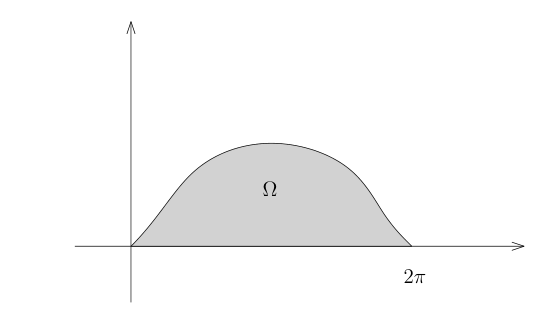

# 勘误：49 散度定理与 Green 公式

[返回勘误目录](../../errata.md) · [数学分析 2 勘误](../02-math-analysis-ii.md)

[相关正文：49：散度定理与 Green 公式](../../02-math-analysis-ii/49-vector-calculus.md)

## 数学修正

**原文：**

> 与 $y = 0$ 所围成的区域。

**修正：**

> 与 $y = 0$ 所围成的区域，其中 $a>0$。

**理由：** 后面的上半平面区域、积分次序及正向x参数化使用了a为正这一条件；a=0使区域退化，a为负会改变区域位置与积分限，故明确这一参数条件。

**原文：**

> $x \in [0, 2\pi]$

**修正：**

> $x \in [0, 2\pi a]$

**理由：** 摆线参数化给出x(0)=0、x(2π)=2πa，且a为正时x单调，所以图像的横坐标区间终点应为2πa。原文漏乘a。

**原文：**

> ```text
> 
> ```

**修正：**

> 图示对应 $a=1$。
>
> 

**理由：** 原图横坐标终点标成2π，而一般参数的终点为2πa；将图明确为a=1的示意图，使图中标注与一般参数化相容。

**原文：**

> $$\int_{\Omega} y^2 dxdy = \int_{0}^{2\pi} \left( \int_{0}^{f(x)} y^2 dy \right) dx$$
> $$= \int_{0}^{2\pi} \frac{1}{3} f(x)^3 dx.$$

**修正：**

> $$\int_{\Omega} y^2 dxdy = \int_{0}^{2\pi a} \left( \int_{0}^{f(x)} y^2 dy \right) dx$$
> $$= \int_{0}^{2\pi a} \frac{1}{3} f(x)^3 dx.$$

**理由：** 这两行都是按横坐标x积分，摆线的横坐标范围为0到2πa；参数t的范围才是0到2π。两处x积分上限共同补上a。

**原文：**

> $$x = a \arccos\left(1 - \frac{y}{a}\right) - \sqrt{y(2a - y)}.$$

**修正：**

> $$x = \begin{cases}
> a\arccos\left(1-\frac{y}{a}\right)-\sqrt{y(2a-y)}, & 0\le t\le\pi,\\
> 2\pi a-a\arccos\left(1-\frac{y}{a}\right)+\sqrt{y(2a-y)}, & \pi\le t\le2\pi.
> \end{cases}$$

**理由：** 原公式只适用于摆线的左半支，因为arccos的主值属于0到π且此处正弦非负。右半支应取t=2π−arccos(1−y/a)，正弦变号；补全两支才可按y使用Fubini公式。

**原文：**

> $$\int_{0}^{2\pi} \left( \int_{0}^{f(x)} y^2 dy \right) dx = \int_{0}^{2\pi} \frac{1}{3} f(x)^3 dx.$$

**修正：**

> $$\int_{0}^{2\pi a} \left( \int_{0}^{f(x)} y^2 dy \right) dx = \int_{0}^{2\pi a} \frac{1}{3} f(x)^3 dx.$$

**理由：** 该等式的两个积分变量都是x，区域在x轴上的投影是0到2πa；原文把参数t的终点2π误用于x积分。

**原文：**

> $$\int_{\Omega} y^2 dxdy = \int_{0}^{2\pi} \varphi(x, f(x)) dx,$$

**修正：**

> $$\int_{\Omega} y^2 dxdy = \int_{0}^{2\pi a} \varphi(x, f(x)) dx,$$

**理由：** 被积函数写作φ(x,f(x))且积分变量为x，因此积分上限应为横坐标终点2πa；与本页其他x积分限一起修正。

[相关正文：49：散度定理与 Green 公式](../../02-math-analysis-ii/49-vector-calculus.md)

## 数学修正

**原文：**

> $$\int_{\Omega} y^2 dxdy = \int_{0}^{2\pi} \varphi(x, f(x)) dx$$

**修正：**

> $$\int_{\Omega} y^2 dxdy = \int_{0}^{2\pi a} \varphi(x, f(x)) dx$$

**理由：** 换元前是横坐标x积分，应在0到2πa上积分；换元之后的参数t仍取0到2π，后一行保持正确的参数积分限。

**原文：**

> $$\int_{\Omega} y^2 dxdy = \int_{0}^{2\pi} \frac{1}{3} f(x)^3 dx$$

**修正：**

> $$\int_{\Omega} y^2 dxdy = \int_{0}^{2\pi a} \frac{1}{3} f(x)^3 dx$$

**理由：** 这里仍然是沿x的积分，摆线横坐标终点为2πa。下一行t积分从0到2π正确，不作改变。

**原文：**

> 此时，$\Omega$ 的下边界对积分没有贡献，因为 $\nu_2$，这个边界落在向 $y$ 轴投影的奇异点集中。

**修正：**

> 此时，$\Omega$ 的下边界对积分没有贡献，因为在 $y=0$ 上有 $\varphi(x,0)=0$，所以 $\varphi\nu_2=0$。

**理由：** 下边界的单位外法向量为(0,−1)，其第二分量并非零，且向x轴的投影并不奇异。该通量消失的正确原因是选取的φ=y³/3在下边界为零。原图的ν₂后句残缺且归因错误。

**原文：**

> $$\int_{D} y^2 dxdy = \int_{D} \operatorname{div}(0, \frac{1}{3}y^3) dxdy.$$

**修正：**

> $$\int_{\Omega} y^2 dxdy = \int_{\Omega} \operatorname{div}(0, \frac{1}{3}y^3) dxdy.$$

**理由：** 本例始终把积分区域记作Ω，D没有定义；同一散度计算中的两处区域下标统一为Ω，不改变散度恒等式。

**原文：**

> $\Omega$ 为 $\mathbb{R}^n$ 的标准球面

**修正：**

> $\Omega$ 为 $\mathbb{R}^n$ 的标准球

**理由：** 本段研究带边区域Ω并把它的边界上的积分分解为图像积分，所以应以标准球为Ω、以标准球面为其边界；若Ω本身是球面，则不符合这里的区域及边界维数。

[相关正文：49：散度定理与 Green 公式](../../02-math-analysis-ii/49-vector-calculus.md)

## 数学修正

**原文：**

> $X$ 是区域 $U \subset \mathbb{R}^n$ 上的光滑向量场。

**修正：**

> $X$ 是区域 $\Omega \subset \mathbb{R}^n$ 上的光滑向量场。

**理由：** 后面的曲线C及其参数化都位于Ω，X必须在Ω上定义才能评价X(γ(t))；本段的U未与Ω建立任何关系，统一为已固定的Ω。

**原文：**

> 我们它可以用光滑的参数化

**修正：**

> 我们假设它可以用光滑的参数化

**理由：** 原图这一句话遗漏假设两字，补全后明确本定义采用给定曲线的光滑参数化，后面的积分定义保持不变。

[相关正文：49：散度定理与 Green 公式](../../02-math-analysis-ii/49-vector-calculus.md)

## 数学修正

**原文：**

> $$X = \sum_{i=1}^{n} X_k \frac{\partial}{\partial x_k},$$

**修正：**

> $$X = \sum_{k=1}^{n} X_k \frac{\partial}{\partial x_k},$$

**理由：** 原图求和指标写i而被求和项使用k，导致k自由且i未出现在项中。向量场坐标展开应对分量指标k求和。

[相关正文：49：散度定理与 Green 公式](../../02-math-analysis-ii/49-vector-calculus.md)

## 数学修正

**原文：**

> $$ \nabla \cdot X = \operatorname{div} X, \quad (X \cdot \nabla) Y = \nabla_X Y = \sum_{i=1}^3 X_i \frac{\partial Y_i}{\partial x_i}, \quad \Delta \varphi = \sum_{i=1}^3 \frac{\partial^2 \varphi}{\partial x_i^2}, $$

**修正：**

> $$ \nabla \cdot X = \operatorname{div} X, \quad (X \cdot \nabla) Y = \nabla_X Y = \sum_{i=1}^3 X_i \frac{\partial Y}{\partial x_i}, \quad \Delta \varphi = \sum_{i=1}^3 \frac{\partial^2 \varphi}{\partial x_i^2}, $$

**理由：** 沿X的方向导数应为向量场Y的方向导数，逐分量结果是ΣX_i∂Y_j/∂x_i。原图误把Y加上求和指标i而得到标量，去掉此下标才与左侧及后续旋度恒等式类型一致。

[相关正文：49：散度定理与 Green 公式](../../02-math-analysis-ii/49-vector-calculus.md)

## 数学修正

**原文：**

> 是 $\partial \gamma$ 的外法向量

**修正：**

> 是 $\partial \Omega$ 的外法向量

**理由：** γ是局部参数化而Ω是区域，外法向量属于区域边界∂Ω；∂γ并没有本段所需的外法向量含义，原图的边界记号误用γ。

**原文：**

> $$ \begin{aligned} \int_{\partial \Omega} Pdx + Qdy &= \int_{\partial \Omega} \left\langle X, \frac{\gamma'(t)}{|\gamma'(t)|} \right\rangle d\sigma \\ &= \int_{\partial \Omega} -P\nu_1 + Q\nu_2 d\sigma. \end{aligned} $$

**修正：**

> $$ \begin{aligned} \int_{\partial \Omega} Pdx + Qdy &= \int_{\partial \Omega} \left\langle X, \frac{\gamma'(t)}{|\gamma'(t)|} \right\rangle d\sigma \\ &= \int_{\partial \Omega} -P\nu_2 + Q\nu_1 d\sigma. \end{aligned} $$

**理由：** 本页已经给出正向单位切向量为(−ν₂,ν₁)，与(P,Q)的内积应为−Pν₂+Qν₁。原图下标互换，修正后才与下一页散度(Q,−P)的边界通量一致。

[相关正文：49：散度定理与 Green 公式](../../02-math-analysis-ii/49-vector-calculus.md)

## 数学修正

**原文：**

> $$ f_i(\gamma(0)) = f(p_0) = 0. $$

**修正：**

> $$ f_i(\gamma(0)) = f_i(p_0) = 0. $$

**理由：** 定义M用的是各个函数f_i的零点，本处也在逐个固定i计算，原图右侧漏掉函数下标i。

**原文：**

> 因为 $X \in T_p M$

**修正：**

> 因为 $X(p) \in T_p M$

**理由：** 向量场X整体不属于一个点的切空间，属于T_pM的是X在p处的值X(p)，与上一页给出的向量场定义一致。

**原文：**

> $$ \Phi_{t_0} : \mathbb{R}^n \to \mathbb{R}^n, \quad x \mapsto \Phi_{t_0}(x), $$

**修正：**

> $$ \Phi_{t_0} : M \to M, \quad x \mapsto \Phi_{t_0}(x), $$

**理由：** 此处讨论的是一般子流形M上的向量场，解的初始点x取于M；只有特例M等于整个Rn才有原写的定义域。将流映射的定义域写为M。

**原文：**

> $$ \Phi_{t_0} : \mathbb{R}^n \to \mathbb{R}^n, \quad x \mapsto \Phi_{t_0}(x), $$

**修正：**

> $$ \Phi_{t_0} : M \to M, \quad x \mapsto \Phi_{t_0}(x), $$

**理由：** 一般子流形M上的流把初值x映射到仍在M上的解的位置，故值域应为M；与本式定义域的修正配套。

**原文：**

> $\Phi_t(p_0) = \gamma(t_0)$

**修正：**

> $\Phi_{t_0}(x) = \gamma(t_0)$

**理由：** 本段固定时间t₀并以初值x定义Φ_t₀(x)，右侧也评价γ(t₀)。原图混用了t、p₀，统一为本段已固定的时间和初值。

**原文：**

> 我们考虑考虑两条曲线

**修正：**

> 我们考虑两条曲线

**理由：** 原图重复了考虑一词，去掉重复后保留流的群性质证明及两条曲线。

**原文：**

> $$ \begin{aligned} \gamma_1 : \mathbb{R} &\to M, \quad t \mapsto \Phi_{t_0+t}(p_0), \\ \gamma_2 : \mathbb{R} &\to M, \quad t \mapsto \Phi_t (\Phi(p_0)). \end{aligned} $$

**修正：**

> $$ \begin{aligned} \gamma_1 : \mathbb{R} &\to M, \quad t \mapsto \Phi_{t_0+t}(p_0), \\ \gamma_2 : \mathbb{R} &\to M, \quad t \mapsto \Phi_t (\Phi_{t_0}(p_0)). \end{aligned} $$

**理由：** 原图内层Φ漏掉时间下标，必须取Φ_t₀(p₀)才能使第二条曲线在t=0时与第一条Φ_t₀+t(p₀)有相同初值。

## 未决数学问题

**原文：**

> $$ f_i(\gamma(t))' = \nabla_{\gamma'(t)} f_i(\gamma(t)) = \nabla_{X(\gamma(t))} f_i = 0, $$

**问题：** 本段用X(p)切于M说明最后一个导数为零，但这只能在γ(t)已属于M时使用，恰好又是本段待证的结论；而X起初只在M上定义。若从环境空间求解，需先选局部延拓并用唯一性证明M不变；若在M的坐标图内求解，则需明确该构造。现有文字不足以唯一确定作者采用哪一种构造，保留为证明缺口。

[相关正文：49：散度定理与 Green 公式](../../02-math-analysis-ii/49-vector-calculus.md)

## 数学修正

**原文：**

> $$ \Phi_{t*} m = e^{\int_0^t \operatorname{div}(\Phi_\tau(x)) d\tau} m $$

**修正：**

> $$ \Phi_{t*} m = e^{\int_0^{-t} (\operatorname{div}X)(\Phi_\tau(x))\,d\tau} m $$

**理由：** 推前测度在像点x处的密度是逆流Φ_−t的Jacobian，所以积分时间应为−t，被积函数应为(div X)(Φ_τ(x))。取X(x)=x时Φ_t(x)=e^t x，推前Lebesgue测度的密度为e^−nt，可直接检验此符号。下一页对固定区域计算也给出了相应负号。

[相关正文：49：散度定理与 Green 公式](../../02-math-analysis-ii/49-vector-calculus.md)

## 数学修正

**原文：**

> $$
> \left. \frac{d}{dt} \right|_{t=0} \Phi_{t*}m(\Omega) = \int_{\partial\Omega} X \cdot (-\nu) \, dx.
> $$

**修正：**

> $$
> \left. \frac{d}{dt} \right|_{t=0} \Phi_{t*}m(\Omega) = \int_{\partial\Omega} X \cdot (-\nu) \, d\sigma.
> $$

**理由：** 右侧积分在边界超曲面∂Ω上，应使用本章定义的子流形测度dσ；n维Lebesgue测度dx不能表示此边界通量。原图末尾测度误写dx。
